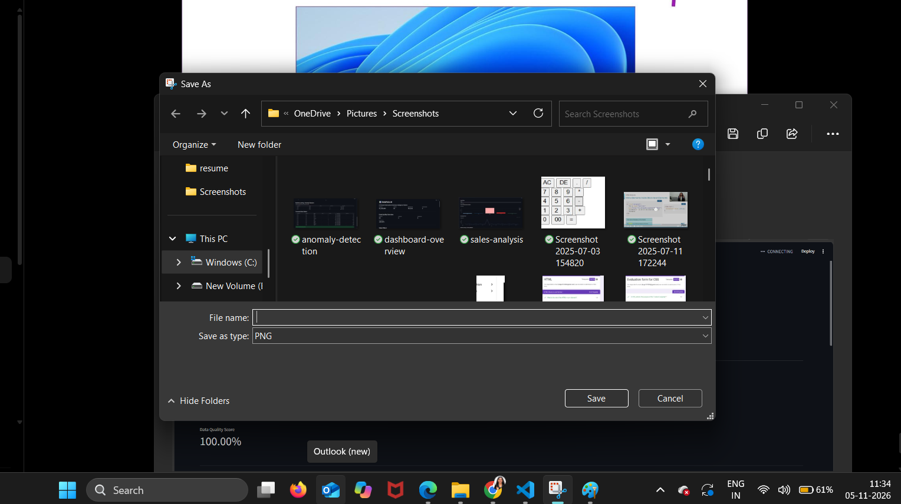
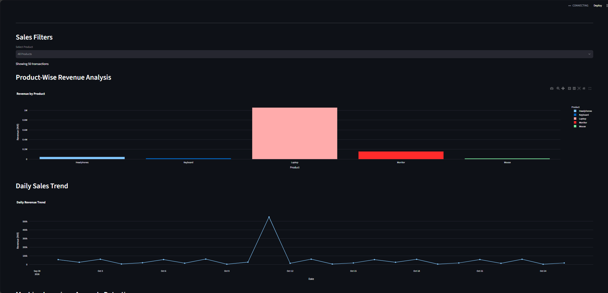
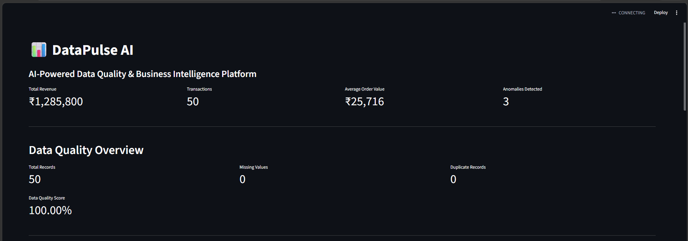

# 📊 DataPulse AI
### AI-Powered Data Quality, Anomaly Detection & Business Intelligence Platform

DataPulse AI is an end-to-end data analytics platform that processes raw sales data, identifies data quality issues, performs business analysis, detects unusual transactions using Machine Learning, and presents insights through an interactive dashboard.

## 🚀 Key Features

- **Data Cleaning:** Handles missing values and duplicate records.
- **Data Quality Monitoring:** Calculates missing values, duplicate records and data quality score.
- **Business Analytics:** Calculates revenue, transactions, average order value and product performance.
- **Interactive Dashboard:** Displays KPI cards, product filters and sales charts.
- **Anomaly Detection:** Uses Isolation Forest to identify unusual transactions.
- **REST API:** Provides analytics through FastAPI endpoints.

## 🛠️ Tech Stack

| Category | Technologies |
|---|---|
| Programming | Python |
| Data Processing | Pandas, NumPy |
| Machine Learning | Scikit-learn, Isolation Forest |
| Visualization | Streamlit, Plotly |
| Backend API | FastAPI |
| Version Control | Git, GitHub |

## 📁 Project Structure

```text
DataPulse-AI/
├── backend/
│   ├── data_processor.py
│   └── main.py
├── dashboard/
│   └── app.py
├── data/
│   ├── sales_data.csv
│   └── processed_sales_data.csv
├── ml/
│   └── anomaly_detector.py
├── reports/
│   ├── anomaly_results.csv
│   ├── product_analysis.csv
│   ├── daily_sales_analysis.csv
│   └── daily_sales_chart.html
├── requirements.txt
└── README.md
```

## 📸 Dashboard Screenshots

### 1. Dashboard Overview


### 2. Sales Analysis


### 3. Anomaly Detection



## 📈 Sample Results

| Metric | Result |
|---|---:|
| Total Revenue | ₹1,285,800 |
| Total Transactions | 50 |
| Average Order Value | ₹25,716 |
| Anomalies Detected | 3 |
| Data Quality Score | 100% after cleaning |

## ⚙️ How to Run

### 1. Clone the repository

```bash
git clone https://github.com/Durga-1235/DataPulse-AI.git
cd DataPulse-AI
```

### 2. Create and activate virtual environment

```bash
python -m venv venv
venv\Scripts\activate
```

### 3. Install dependencies

```bash
pip install -r requirements.txt
```

### 4. Run the dashboard

```bash
streamlit run dashboard/app.py
```

### 5. Run the FastAPI backend

Open another terminal:

```bash
uvicorn backend.main:app --reload
```

Open API documentation:

`http://127.0.0.1:8000/docs`

## 🧠 Machine Learning

The project uses the Isolation Forest algorithm to identify unusual sales transactions based on numerical transaction features.

Anomaly detection is intended to highlight records for further investigation, not to prove fraud.

## 🎯 Project Objective

To build a practical data intelligence solution that combines data engineering, data analytics, machine learning and business intelligence in one platform.

## 👨‍💻 Author

Durga T
